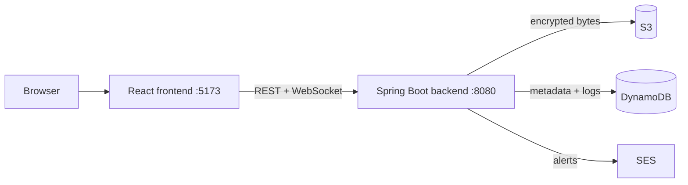

# VanishVault

**Share files that self-destruct. Password-protected, AES-256 encrypted, with expiry timers, download limits and burn-after-read.**


<!-- Replace with a real screenshot or GIF of the upload flow and dashboard:

-->

## What it does

Upload a file, set a password, and get a shareable link plus QR code. The file is encrypted with a fresh AES-256 key before it reaches S3. The recipient enters the password to download; three wrong guesses destroy the file. Links expire after a time you choose, after a download limit, or immediately after the first download if burn-after-read is on.

The sender's dashboard shows every access event live over WebSockets, and the sender can revoke a link at any time.

## Features

- AES-256 server-side encryption before storage in S3
- Password protection with bcrypt hashing and a strength meter
- Expiry timers (5 minutes to 24 hours), download limits and burn-after-read
- Auto-destruct after three failed password attempts
- Optional IP lock on a file
- Live activity feed over STOMP/WebSocket: opened, wrong password, deleted
- Optional email alerts via Amazon SES
- Access logs per file in DynamoDB
- Manual link revocation and QR code sharing

## Architecture



**Stack:** Java 21, Spring Boot 4, Spring WebSocket (STOMP), Spring Security Crypto, AWS SDK v2 · React 19, Vite, Tailwind CSS 4, Axios · S3, DynamoDB, SES

## Quick start

Requires Java 21, Node 20+ and an AWS account with an S3 bucket and two DynamoDB tables (see [Configuration](docs/CONFIGURATION.md)).

```bash
git clone https://github.com/hirtic-s/VanishVault.git
cd VanishVault

# Backend
cp src/main/resources/application.yml.example src/main/resources/application.yml
# Edit application.yml: AWS keys, region, bucket and table names
./mvnw spring-boot:run

# Frontend (new terminal)
cd frontend
npm install
npm run dev
```

Open **http://localhost:5173**, pick a file, set a password and generate a link.

## Usage

The UI covers the whole flow. The API can also be called directly:

```bash
# Upload (returns the share link)
curl -X POST http://localhost:8080/api/upload \
  -F file=@secret.pdf -F password=hunter22 -F senderId=me \
  -F expiryMinutes=30 -F maxDownloads=1

# Download with the password
curl -X POST http://localhost:8080/api/file/<fileId>/verify \
  -H "Content-Type: application/json" \
  -d '{"password":"hunter22"}' -o secret.pdf
```

## Documentation

- [API reference](docs/API.md) — endpoints, request and response shapes, WebSocket events
- [Configuration](docs/CONFIGURATION.md) — AWS setup, environment, deployment, known limitations

---

Built by **Hirtic** · [GitHub](https://github.com/hirtic-s) · [hirtic.com](https://hirtic.com)
